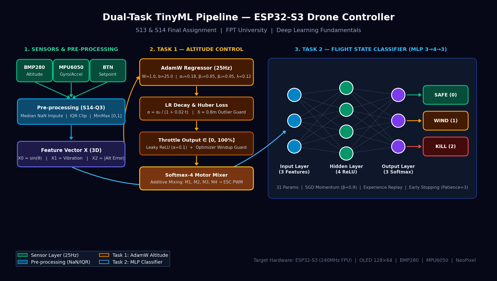
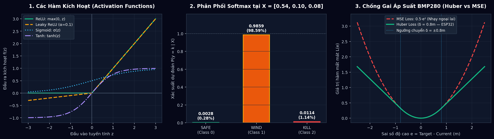
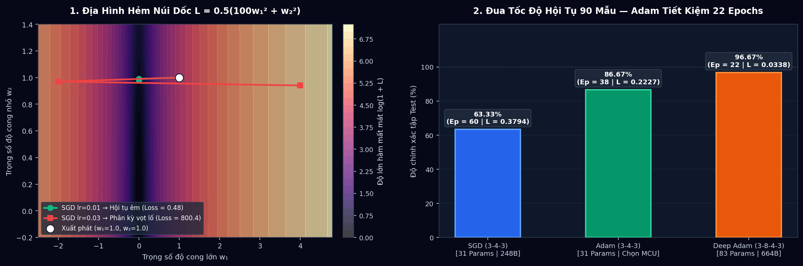
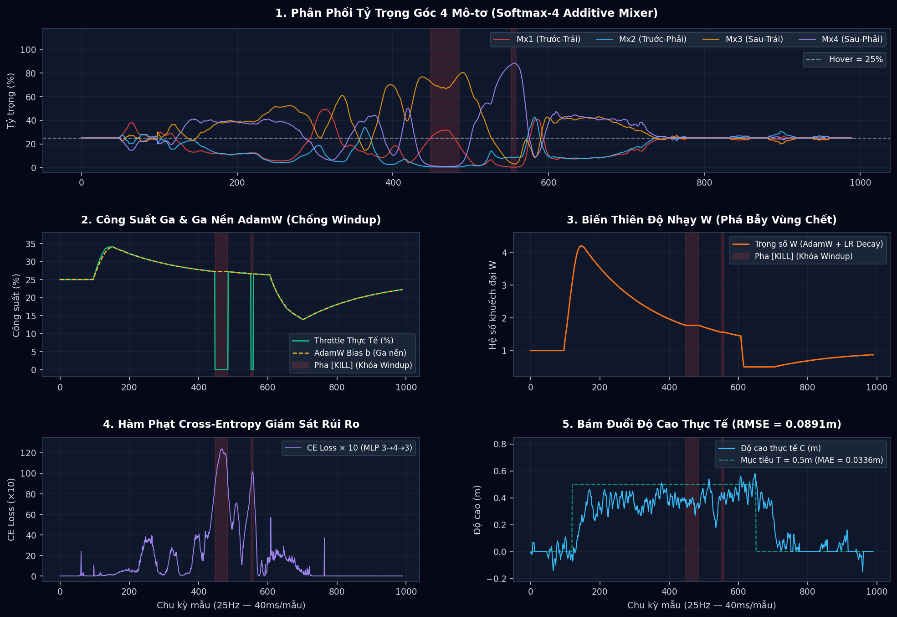
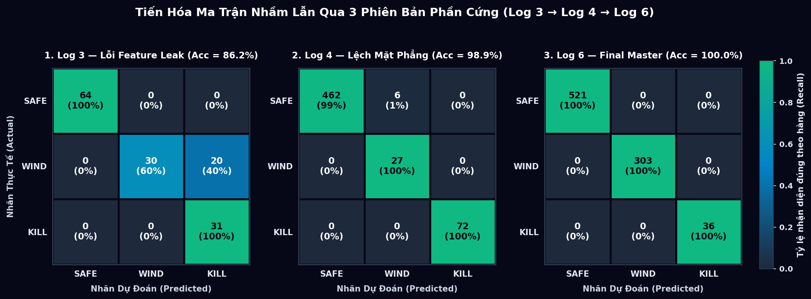
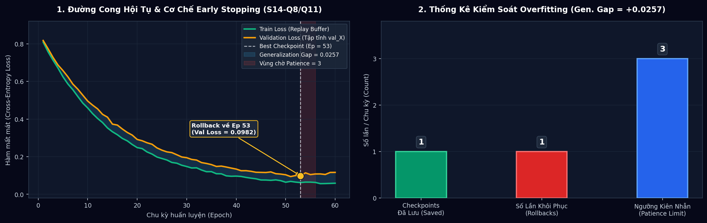

# DLF_TINYML_ESP32_DRONE — Dual-Task TinyML Pipeline trên ESP32-S3

> **Personal Research Project | Hoàng Đức Duy**  
> Embedded TinyML & Adaptive Flight Control on ESP32-S3

---

## Tổng quan

Dự án này triển khai hệ thống **Dual-Task TinyML** trên vi điều khiển **ESP32-S3**, bao gồm:

| Task | Mô tả | Thuật toán |
|------|-------|------------|
| **Task 1** | Điều khiển độ cao drone | AdamW + LR Decay |
| **Task 2** | Phân lớp trạng thái bay (SAFE/WIND/KILL) | MLP 3→4→3 + SGD Momentum |

---

## Cấu trúc thư mục

```
DLF_TINYML_ESP32_DRONE/
├── dlf_tinyml_esp32_drone.py     # 🐍 Python pipeline chính (3 mode)
├── DLF_TINYML_ESP32_DRONE_Final_Master.ino    # ⚙️  Firmware C++ (Arduino/ESP32-S3)
├── DLF_TINYML_ESP32_DRONE.docx         # 📄 Đề bài gốc
├── data/
│   ├── log_serial_monitor_3.txt   # Log phiên 3 (201 mẫu)
│   ├── log_serial_monitor_4.txt   # Log phiên 4 (642 mẫu)
│   └── log_serial_monitor_6.txt   # Log phiên 6 (990 mẫu, FINAL)
├── figures/
│   ├── cover.png                           # Sơ đồ kiến trúc Dual-Task
│   ├── fig1_activations_and_huber.png      # Hàm kích hoạt & Huber Loss
│   ├── fig2_steep_valley_and_benchmark.png # Hẻm núi dốc & Benchmark
│   ├── fig3_flight_telemetry_adamw.png     # Telemetry 990 mẫu
│   ├── fig4_confusion_matrices_evolution.png  # Confusion matrix 3 phiên
│   └── fig5_early_stopping_gap.png         # Early Stopping & Gen. Gap
├── evidence/                   # Ảnh chụp màn hình phần cứng
└── BAO_CAO_DLF_TINYML__ESP32_DRONE_FINAL.md       # Báo cáo học thuật đầy đủ
```

---

## Yêu cầu môi trường

```bash
Python 3.11+
numpy >= 2.0
matplotlib >= 3.9
```

Không dùng sklearn, TensorFlow, PyTorch hay bất kỳ ML framework nào.

---

## Cách chạy

```bash
# Chạy toàn bộ 3 mode + sinh 6 biểu đồ
python dlf_tinyml_esp32_drone.py

# Chỉ mode lý thuyết (Phần 1-5)
python dlf_tinyml_esp32_drone.py --theory

# Chỉ phân tích telemetry Log 6
python dlf_tinyml_esp32_drone.py --telemetry

# Chỉ bảng tiến hóa sửa lỗi (3 log)
python dlf_tinyml_esp32_drone.py --evolution
```

---

## 3 Mode hoạt động

### `mode_theory()` — Lý thuyết Phần 1→5
- **Phần 1**: Forward pass MLP tại `X=[0.54, 0.10, 0.08]` → probs, CE_Loss
- **Phần 2**: C++ vs Python Parity Check
- **Phần 3**: Gradient Check numerical (float64, eps=1e-6)
- **Phần 4**: Hẻm núi dốc `L=0.5*(100w₁²+w₂²)`, SGD lr=0.01 vs 0.03
- **Phần 5**: Benchmark 90 mẫu seed=42, 3 mô hình

### `mode_telemetry()` — Phân tích Log 6
- Regex parser bóc tách 990 mẫu telemetry thực tế
- Trích xuất bảng nghiệm thu: MAE/MSE/RMSE, Confusion Matrix, Early Stopping
- Xử lý dòng `RMSE/MAE_Ratio=` bị ngắt xuống dòng trong log

### `mode_debug_evolution()` — Tiến hóa 3 phiên
- So sánh Log 3 → Log 4 → Log 6
- Bảng: Adam epoch hội tụ, accuracy, MAE, Gen. Gap, Confusion Matrix
- Vẽ 3 heatmap confusion matrix theo tiến trình sửa lỗi

---

## Kết quả thực nghiệm (Log 6 — FINAL)

### Benchmark 90 mẫu (seed=42, từ log thực tế)

| Mô hình | Params | Epoch Đích | Train Loss | Test Acc |
|---------|--------|-----------|------------|----------|
| 3-4-3 (SGD) | 31 | 60 | 0.3794 | 63.33% |
| 3-4-3 (Adam) | 31 | **38** | 0.2227 | **86.67%** |
| 3-8-4-3 (Deep) | 83 | **22** | 0.0338 | **96.67%** |

> Adam tiết kiệm **22 Epochs (66 Updates)** so với SGD!

### Hồi quy độ cao (947 mẫu thực tế)

| Chỉ số | Giá trị |
|--------|---------|
| MAE | **0.0336 m** |
| MSE | 0.0079 m² |
| RMSE | **0.0891 m** |
| RMSE/MAE Ratio | **2.653** (Fat-tail > 1.25 ✓) |

### Confusion Matrix (Log 6 — 860 mẫu phân lớp)

| | Pred SAFE | Pred WIND | Pred KILL |
|---|---|---|---|
| **Actual SAFE** | **521** | 0 | 0 |
| **Actual WIND** | 0 | **303** | 0 |
| **Actual KILL** | 0 | 0 | **36** |

**Precision = Recall = F1 = 1.000** cho cả 3 lớp ✅

### Early Stopping (S14-Q8/Q11)

- Generalization Gap: **+0.0257**
- Checkpoint Saved: **1**
- Rollbacks: **1**

---

## Kiến trúc phần cứng

| Thành phần | Chi tiết |
|-----------|---------|
| MCU | ESP32-S3 |
| Màn hình | OLED SSD1306 128×64 |
| Cảm biến áp suất | BMP280 (độ cao) |
| IMU | MPU6050 (gyro/accel) |
| LED | NeoPixel WS2812 |
| Điều khiển | 4× ESC |

---

## Biểu đồ kết quả












